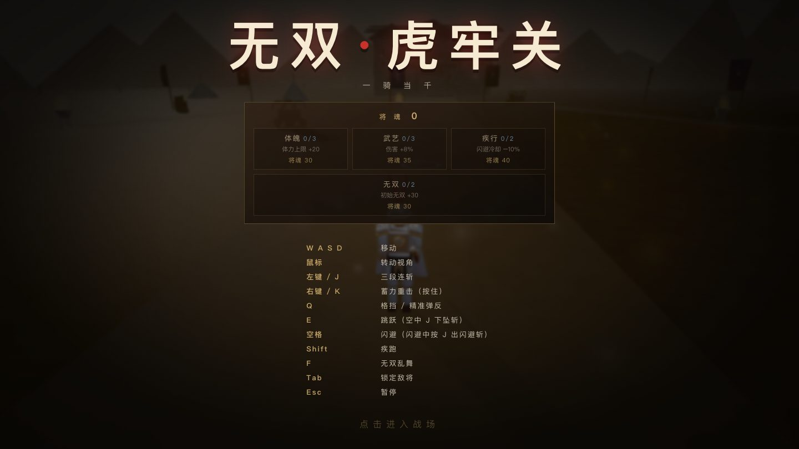

# 无双 · 虎牢关

**在线试玩：<https://let5sne.github.io/zhen-sanguowushuang/>**（无需安装，桌面端 Chrome / Safari / Edge）

> 发布新版本：`scripts/publish_pages.sh`（把 `demos/index.html` 推到 `gh-pages` 分支根目录）


用「一句话 → 可玩游戏」的方式做出来的浏览器割草动作游戏。单文件 HTML，零外部资源——模型、贴图、音效、UI 全部由代码生成。

渲染层在 2026-11 做了一次「实时照片级」升级：HDR 光照链、双级联阴影、程序化 PBR、骨骼动画角色。



## 快速开始

```bash
# 方式一：直接双击打开
open demos/index.html

# 方式二：本地服务器（推荐）
cd demos && python3 -m http.server 8000
# 打开 http://127.0.0.1:8000
```

需要联网（从 CDN 加载 three.js r160）。

## 操作

| 输入 | 动作 |
|---|---|
| `W A S D` | 移动 |
| 鼠标 | 转动视角（点击画面锁定鼠标；未锁定时可拖动） |
| 左键 / `J` | 三段连斩，第三段击倒 |
| 右键 / `K` | 蓄力重击（按住蓄力，越久越痛，带冲击波） |
| `Q` | 格挡（按住，减伤 80%）；**0.16 s 内按下 = 精准弹反**：无伤 + 0.2 s 顿帧 + 震退周围敌人 + 无双槽 +8 |
| `E` | 跳跃（空中按 `J` 触发**下坠斩**：快速落地 + 3.9 m 范围 46 点伤害） |
| `空格` | 闪避（短暂无敌） |
| `Shift` | 疾跑 |
| `F` | 无双乱舞（槽满时） |
| `R` | **处刑**（敌将架势满且 5 m 内）：420+ 伤害、回 32 体力、1.1 s 慢动作 |
| `Tab` | 锁定最近的敌将 |
| `Esc` | 释放鼠标 |

## 玩法

- **北岭哨塔**（二级据点，位于 (−66, 54)）：石砌基座 + 木构平台 + 四坡顶盖 + 梯子 + 双旗 + 木箱 + 拒马，
  半径 4.6 m 的碰撞体，可作掩体绕行；给大地图一个远处可见的视觉锚点。
- 虎牢关外平原，**战场半径 118 m**（旧版 62，面积约 3.6 倍），关楼位于 z = −74，土路从出生点直通关门并向两翼开出支道。
- 刀兵 / 枪兵 / 弓兵三种杂兵，同屏 60 人以上。
- 敌将 **华雄**（620）→ **吕布**（1500，带护卫）。两人体型更大、雉鸡翎 + 方天画戟，与杂兵一眼可分。讨取吕布即胜利。
- 击破数、连击数、评级（C/B/A/S/无双）、计时；每 25 击破回复 22 点体力。
- 无双槽靠命中与受击积攒，满槽后 4 秒无敌旋转攻击。
- **局内成长**：每 25 击破（同时回 22 体力）弹出三张强化卡，按 `1/2/3` 或点击择一，**不暂停战斗**，10 秒不选自动取第一张。
  强化池 9 种，**数值向与定性向各半**（定性向改变打法而非数字，便于形成 build）：
  - 数值：烈刃（伤害 +18%）/ 横扫（范围 +15%）/ 铁壁（体力上限 +25 并回满）/ 龙胆（无双槽 +25%）
  - 定性：**饮血**（命中回 0.8 体力）/ **闪反**（完美闪避后下一击必暴击 ×2）/ **雷刃**（无双期间攻击溅射）
    / **破军**（重击伤害 +60%，但出招 −20%）/ **疾风步**（闪避冷却 −40%）
  实测：饮血 +0.8/命中；闪反 19 → 41 伤害；破军重击 power 1.5 → 2.4（伤害 86 → 138）；
  疾风步闪避 CD 0.55 → 0.33 s；雷刃溅射 74 伤害。
- **锁定吸附**：锁定敌将时轻击/重击会把朝向拉到目标并小幅前移，显著减少 60 人混战里的挥空。
- **格挡 / 弹反**：`Q` 按住减伤 80%（不进硬直、不断连击）；受击前 0.16 s 内按下为**精准弹反**——无伤 + 0.2 s 顿帧 + 震退面前敌人 + 无双槽 +8。
- **元成长（跨局）**：`localStorage` 持久化的**将魂**与永久被动，标题页可购买（点强化不会误触开始游戏）。
  | 被动 | 效果 | 上限 | 价格（将魂） |
  |---|---|---|---|
  | 体魄 | 体力上限 +20 | 3 | 30 / 55 / 80 |
  | 武艺 | 伤害 +8% | 3 | 35 / 65 / 95 |
  | 疾行 | 闪避冷却 −10% | 2 | 40 / 75 |
  | 无双 | 初始无双 +30 | 2 | 30 / 60 |
  将魂收入：每 10 击破 +1、每名敌将 +8、完成支线 +3。
  实测：初始 120 体力 → 买 2 级体魄 → 开局 **160**；刷新页面后仍保留（valor 115 / perks {body:2} / runs 1）。
- **战斗外目标（支线）**：每约 18 s 刷新一个，HUD 顶部显示名称/进度/倒计时，三种：
  | 支线 | 条件 | 奖励 |
  |---|---|---|
  | 讨伐令 | 45 s 内击破 40+10×(N−1) 人 | 体力 +30、无双 +25 |
  | 无伤 | 30 s 内不受伤害 | **追加一次三选一强化** |
  | 讨敌 | 20 s 内击败当前敌将（仅敌将存活时出现） | 体力/无双全满 + 追加一次强化 |
  失败进入 12 s 冷却，成功进入 18 s 冷却。
- **可破坏物（粮车 / 木箱）**：场上 9 个，各有碰撞体（挡人也挡敌人）。打爆后**范围 4.2 m、90 点伤害并击飞**周围敌人，
  碰撞体停用、模型隐藏，**18 s 后原地重生**（带缩放出现动画）。粮车 70 血、木箱 45 血。
- **关楼门洞**：关楼碰撞体拆为左右两段（中间 6 m 通道），闸门抬起表示开启。
  玩家可站在门洞里**卡位形成割草漏斗**——敌人被两侧墙体挡住，只能从门洞挤进来。实测：中间穿到 −81.6，墙体侧被挡在 −69.1。
- **三段机器人对照（60 人 / 30 s / 各 2 轮取均值）**：
  | 打法 | 平均击破 | 平均阵亡 |
  |---|---|---|
  | 无脑连点 J | 35.5 | 23.75 s |
  | 混合（垫刀→重击→闪避） | 39.0 | 24.5 s |
  | **进阶（击飞→跳跃→空中斩→震波）** | **45.5** | **25.1 s** |
  技能梯度成立：连点 → 混合 → 进阶逐级提升（+28%）。
  注：第一轮实验进阶打法反而更差（38 vs 40），查出两个原因——① 空中无法行动且击飞伤害低（已加空中护甲/减伤/浮空增伤）；
  ② **bot 时序写错**：重击后摇 0.6 s 内按 E 会被拒，导致空中段从未触发。修正后进阶反超。
- **击飞与浮空**：蓄满重击（蓄力 >1.2）命中会**击飞**敌人（初速 8.2+2.0×power，峰值约 2.1 m、滞空 0.85 s），
  浮空期间敌人无法行动；空中下坠斩的震波也会击飞周围敌人，落地自损 4 点并进入硬直。
  于是形成进攻链：**蓄力重击击飞 → 跳跃 → 空中追击 → 下坠震波**。
- **红色不可格挡**：敌将每 3 次普攻来一发**红色重击**——地面扩散红环预警（0.87 s）、喊话"危 · 不可格挡"、
  伤害 ×1.7、判定范围 +1.4 m。**格挡与霸体都无效**（只有闪避或走开），若强行格挡反而额外吃 25% 伤害。
- **架势（硬直抗性）**：每次命中不再无条件打断敌人。轻击攒 1 点、第三段/闪避斩攒 2 点、**重击无视架势直接打断**；
  攒满才硬直，脱手 2.2 s 后每秒回 0.7 点。上限：刀兵 1 / 弓兵 1 / 枪兵 2 / 盾兵 3 / 敌将 5。
  **机器人对照实验（60 人、30 s 上限、同一起点）**：
  | | 无脑连点 J | 混合操作（垫刀→蓄力重击→闪避） | 差距 |
  |---|---|---|---|
  | 改前 | 38 击破 / 存活 23.6 s | 41 击破 / 23.5 s | 3 击破（8%），存活相同 |
  | 改后 | **27 击破 / 22.4 s** | **39 击破 / 24.3 s** | **12 击破（44%）**，存活多 1.9 s |
  改后无脑连点被单独惩罚（−29%），混合操作几乎无损（−5%）——**攻击方式终于有了取舍**。
- **阵型重整**：每 1.5 s 检查一次，前排存活不足 45% 时把**最靠近玩家的侧翼**提升为前排补位；
  盾兵破防后会主动退为侧翼。实测：12 前排 8 侧翼 → 前排全灭 → 2 s 后自动补成 4 前排 4 侧翼。
- **盾兵**：前排刀兵中**六成持盾**（左前臂挂盾，独立网格），正面来袭减伤 **30%**，累计 3 次轻击或 1 次重击**破防**（进硬直、盾消失、显示"破防"）。
  背后/侧翼攻击不受减伤——所以绕背或用范围技是正解。
- **围攻阵型**：每个杂兵出生时分配角色——刀兵**前排**（正面直推）、枪兵**侧翼**（中距离带切向分量，弧线绕到侧面再收拢）、
  弓兵**后排**（保持 12 m，过近后撤）。实测 40 人 5 s 后包围均匀度 **0.077**（1.0 = 全堆一侧，0 = 均匀环绕）。
- **章节敌人构成变化**（不只是加血）：`COMPOSITION` 表驱动，`rollType()` 决定每个刷兵单位的兵种——
  | 章节 | 刀兵 | 枪兵 | 弓兵 |
  |---|---|---|---|
  | 第 1 章 | 50% | 38% | 12% |
  | 第 2 章 | 40% | 42% | 18% |
  | 第 3 章 | 32% | 40% | 28% |
  | 第 4 章+ | 26% | 38% | 36% |
  弓兵比例上升会同时让**齐射更频繁**（齐射间隔每章 −0.35 s，下限 3.6 s），逼玩家从"正面硬推"转向"走位 + 借掩体"。
  实测各章分布与目标误差 ≤3%。
- **章节循环**：击败华雄→吕布后进入结算（`第 N 章 · 完`），点击"继续进军"进入下一章——
  敌军生命 ×(1+0.12·(N−1))、伤害 ×(1+0.10·(N−1))、目标同屏 60→68→76→…（上限 96），
  玩家回满、击破数清零但**强化保留**，华雄以强化后的属性再临。HUD 顶部显示当前章节。
- **动态难度**：每 2 s 依据表现评估"敌军士气"压力值 `v ∈ [0,1]`（连续高击破且血量健康 → 上升；濒死 → 快速下降），
  只调节**节奏**：刷兵间隔 ×(1.30→0.75)、齐射间隔 ×(1.28→0.80)、敌将技能冷却 ×(1.35→0.75)。
  **不动伤害数值**——否则会破坏验收基线（站桩掉血断言）。跨档时喊话"敌军压下/敌军迟疑"。
- **齐射威胁等级**：同批 6 名以上弓兵为**饱和齐射**——双层预警环（外环 8.4 m → 1.6 m，滞后 18% 收缩）、
  喊话"大阵齐射"、鼓声更重 + 锣声、轻微震屏，齐射间隔从 5.2 s 拉长到 6.4 s。
- **齐射预警**：齐射发动时在玩家当前位置生成收缩环（5.6 m → 1.1 m，1.15 s），颜色由琥珀转红、脉动随收缩加快——
  环收缩到底就是箭落，**站着不动必中，走出去就安全**。
- **弓兵齐射**：每约 5 s 组织一次，≥3 名弓兵同时进入 0.42 s 抬弓前摇后齐射，伴随喊话与鼓声。
- **输入响应**：起步到 90% 速度 **200 → 117 ms**、停止到 10% **167 → 100 ms**（加减速 damp 12/14 → 22/26）；
  转身收敛 **117 ms**（12 → 22）；镜头跟随时间常数 83 → 45 ms。
  攻击输入**全程缓冲**（原先只在 `atkP > 0.2` 后缓冲，起手 3 帧内按下会被丢弃）——实测起手即按 J 现在 383 ms 后接上下一段，旧版直接丢失。
  锁定镜头**不再和鼠标打架**：鼠标活动时完全让位，停手 0.7 s 后才轻柔回正。
  鼠标灵敏度默认 0.0026 → **0.0030**，可用 `?sens=0.004` 覆盖。
- **打击感分级**：伤害函数接受 0..1.2 的权重（兼容旧布尔），权重驱动**顿帧 / 震屏 / 火花数量与色温 / 击退距离**：
  轻1 0.45 → 轻2 0.50 → 轻3 0.80 → 重击 1.00 → 闪避斩 0.70 → 空中斩 1.15 → 处刑 1.20。
  实测顿帧 0.050→0.084 s、震屏 0.15→0.30，单调递增，不同攻击方式靠手感即可区分。
- **闪避派生**：闪避中按 `J` 出**闪避斩**——立即结束闪避、朝锁定目标突进 13 m/s、造成 1.15 倍伤害（stage 2 基础 34 → 约 39）。
  闪避**前 0.14 s** 内被击中触发**完美闪避**：无伤 + 0.4 s 子弹时间 + 无双槽 +8 + **返还闪避 CD**。
- **跳跃 / 空中攻击**：起跳 7.6 m/s、重力 24 m/s²（滞空约 0.67 s、最高 1.13 m）；空中按 `J` 进入下坠斩，落地造成范围伤害并掀尘。
- **敌将技能**：华雄**横扫**（200° 范围 + 击退）；吕布在**冲锋**（15 m/s 突进 + 震地）与**旋风斩**之间随机——
  旋风斩 0.80 s 前摇 → 1.20 s 高速自转 → **3 段范围伤害**（每段 12，共 36，可格挡），逼玩家拉开距离而非硬格。
  实测 40 s 实战：吕布出招 `whirl` 313 帧 / `charge` 248 帧，玩家 120 → 0（21 s 阵亡）。
- **敌将架势与处刑**：敌将血条下多一条蓝色架势条，命中积攒（轻击 +6 / 重击 +15，3 s 不命中开始衰减）。
  攒满后靠近按 `R` 处刑：造成 `max(420, 最大生命 34%)` 伤害、回 32 体力、+18 无双槽、1.1 s 慢动作。
- **敌将专属技能**（独立状态机，带 0.85 s 前摇）：华雄**横扫**（200° 范围 + 击退杂兵）、吕布**冲锋**（15 m/s 突进 + 震地）。
  冷却 6–9 s，前摇期间会喊话提示。
- **霸体槽**：2 格（HUD 上蓝条），蓄力重击期间硬吃攻击只掉 60% 血、**不进硬直、不断连击**；重击挥出瞬间也有 0.45 s 霸体窗口。消耗一格，脱战 2.2 s 回一格。

## 实现要点

### 渲染管线

| 方面 | 做法 |
|---|---|
| 色彩链路 | 场景渲染进 `HalfFloatType` RT（`EffectComposer` 默认即 HDR），中间任何 pass 不降到 8-bit；`renderer.toneMapping = NoToneMapping`，**色调映射由最终 pass 独占**（r160 里渲染进 RT 时 `toneMapping` 本来就失效，明确写出来避免误用） |
| 单位分离 | 空间哈希（100×100 链表网格，零分配）+ 每帧 2 轮位置式分离；149 人同屏 60fps，重叠对 144 → 49 | **静态碰撞体 + 兵器 + 箭矢**：关楼 1 个轴对齐盒（含高度 13 m）+ 营帐 ≤14 个圆（高 3.6 m）。玩家/敌兵每帧做圆-盒 / 圆-圆推出（带切向滑移），并沿朝向前伸采样点检测兵器；解算后仍相交就回退上一帧。箭矢对「上一帧→当前帧」做 3 点采样，低帧率也不穿墙。宽相用外接圆提前剔除。碎石/木箱/火盆太矮可跨过。实测：墙体 549 帧 / 34,194 单位帧零穿模；箭矢 323 箭帧零穿透 |
| 后期 | 5 个 pass：`RenderPass` → 自写 `BattlefieldAtmosphere`（SSAO + 高度雾 + 体积光，半分辨率）→ `UnrealBloomPass` → 自写 Grade（ACES + 曝光 + 对比/饱和/暗角）→ **FXAA**。
  | FXAA 必要性：场景渲进 `EffectComposer` 的 RenderTarget，`renderer antialias` 不生效（那是给默认帧缓冲的），
  | 所以最后在 sRGB 图像上补一道全屏抗锯齿。实测硬边像素（梯度 >60）**0.533% → 0.154%（−71%）**，边缘能量 4.92 → 4.08。
| 大气 | 半分辨率单 pass 完成 SSAO（8 sample + 深度双边模糊）、高度雾（`exp(-h/1.5)` 沿视线积分，系数 .007）、god rays（16 步径向模糊）；复用 `depthTexture`，**无额外 prepass**；合成时雾色混合系数 .26 |
| 阴影 | 双光源级联：主太阳 2048²（半径 20 m）+ 跟随玩家的近端光 2048²（半径 8 m），`PCFSoftShadowMap`；20 m 外由**贴地接触阴影**（`shadowIM`，对全部单位生效）兜底，因此远景单位不会浮空，也无需第三级级联 |
| 环境光 | 程序化 equirect 1024×512 → `PMREMGenerator`；含太阳盘、天空渐变、地面反弹色，太阳方向与平行光一致 |
| 材质 | 5 类 PBR：淬钢（metalness .96 / roughness .26 / anisotropy .38）、织物（sheen .65）、干裂黄土（roughness .9）、木漆（clearcoat .22）、皮肤（thickness + 低强度 sheen）；角色 PBR 贴图 1024²（albedo/roughness/normal），甲片与布料的细grain 在片元着色器里解析生成 |
| 地面 | 2048² 程序化 albedo + 由高度图生成的 normal + roughness；双尺度 UV 去平铺 |
| 后期降级 | `quality ∈ [0.55, 1.0]`，只降渲染比例 / SSAO 采样 / 体积光开关 / 阴影分辨率 / 尘粒数 |

### 角色（骨骼动画）

| 方面 | 做法 |
|---|---|
| 建模 | Blender 5.3 生成 5 套 skinned 角色：赵云 2412 面、刀兵 2148、枪兵 2108、弓兵 2780、敌将 3492；每套 **21 根骨**、**10 个 clip**（idle/walk/run/atk1-3/heavy/hit/die/musou） |
| 蒙皮 | 每顶点 ≤ 2 根权重影响（格式支持 4 槽），肘/膝用**平滑过渡**而非硬切换（消除突跳），权重归一化误差 ~3e-8；实测英雄模型 1353 顶点中 401 个为双权重 |
| 单网格 | 每个角色所有部件合并为**一个 `SkinnedMesh` / 一个材质**，靠顶点色 + 贴图区分——这是 60 人同屏 draw call 不爆的关键 |
| 动画 | `AnimationMixer` + `crossFadeTo`；**按距离分档更新**：≤18 m 60 Hz、18–35 m 20 Hz、35–60 m 10 Hz、>60 m 冻结姿态 |
| 静态合批 | 静态道具按材质合并成 `static-AO-batch`，降低 draw call |

### 性能

| 场景 | 帧率 | draw call | 三角面 |
|---|---|---|---|
| 91 人同屏 | 60 fps | 173 | 866 K |
| 121 人同屏 | 60 fps | 206 | 1.15 M |

画质自适应收敛到 `quality ≈ 0.8`。

**长时间稳定性**（2 分钟压测 / 14 轮刷兵与清场 / 约 900 击破）：fps 全程 60，`renderer.info.memory.geometries` 恒 60、`programs` 恒 39（无几何/着色器泄漏），堆内存 22–46 MB 波动无增长趋势。`textures` 从 130 升到 ~172 后趋稳——这是**每个 `Skeleton` 一份 bone texture** 造成的，上限由槽位数 `MAXE=170` 决定，属有界占用而非泄漏。**注意**：刚大批量刷兵时画质还没降下来，会有数秒的瞬时掉帧（可低至 ~45 fps），约 8 秒后收敛到 60 fps。

**低配预设**：`?low=1` 强制开启、`?low=0` 强制关闭；不带参数时按 GPU 字符串自动判断（Intel Iris/UHD、Adreno、Mali、PowerVR、Apple A 系列）。
开启后：画质下限 0.55 → **0.45**、体积光**关闭**、SSAO 采样 8 → **4**、太阳与近端阴影 2048 → **1024**、尘粒数减半、起始画质 0.7。
实测 118 人 60 fps（体积光关 / SSAO 4 / 阴影 1024 / 亮度 mean 0.454），零报错。

**没有做的两项优化（附实测证据）**：
- **阴影投影分级**：关闭全部单位投影只让 draw call 从 196 降到 195。阴影相机视锥本身只覆盖玩家周围 20 m，远处单位已被自动剔除，再分级无收益。
- **几何 LOD**：带 `gl.finish()` 的同步基准显示，119 人同屏一帧渲染 **2.78 ms**（隐藏全部单位 3.42 ms，降到 0.45 分辨率 2.26 ms）。顶点/像素都不是瓶颈——渲染余量有 6 倍，掉帧来自其它进程抢 CPU，重导低模没有意义。

**性能数据的测量环境（重要）**：下列数字取自 Apple M1 / Chrome / 1440×810、**系统负载 < 3 的空闲机器**。
负载 > 4 时帧率会被其它进程抢占：同一构建在 load 6.8 下 127 人只有 48 fps，但**相对空场的保持率仍有 0.86**（性能本身没退）。
因此 `scripts/verify_photo.py` 在 `load > 4` 或**空场基线 < 55 fps** 时自动降级为「只报告不判定」，并打印保持率；
`scripts/verify.py` 的「≥45 fps」**不设保护**（不可放宽的基线），繁忙机器上会失败——那是环境限制，不是代码退化。
判读方法：先看空场基线，再看保持率；两者正常时绝对帧率才有意义。

### 音频

WebAudio 全程合成：挥空、命中、交击、重击、铜锣、无双、弓弦、脚步；总线过 `DynamicsCompressor`。

配乐是**三层自适应**：战鼓（始终，增益随强度 0.78–1.12）→ 低音持续（强度 > .3 每小节一记）→ 高频反拍碎点（强度 > .65）。强度由连击数驱动（`combo/40`），同时把 bpm 从 88 推到 114，用 0.4 s lookahead 调度避免抖动。

## 目录

```text
zhen-sanguowushuang/
  demos/index.html                  单文件成品（3159 行 / 632 KB）
  prompts/01-musou.md               任务提示词（第一版）
  prompts/02-photo.md               任务提示词（渲染层升级到实时照片级）
  prompts/builder_system.md         系统提示词
  scripts/run.sh                    无人值守 headless 运行器
  scripts/verify.py                 验收：旧 18 条断言
  scripts/verify_photo.py           验收：新 14 条（P1–P14），内部会先跑旧 18 条
  scripts/blender/build_geometry.py 角色部件建模（旧管线，产出的 GEO_B64 仍向后可读）
  docs/screens/                     验收截图
  runs/                             run.sh 产出（已 gitignore）
```

新增的骨骼绑定 / 蒙皮 / clip 的生成脚本以 `BLENDER_RIG_PY` 注释块**内嵌在 `demos/index.html` 末尾**；提取该注释传给 `blender --background --python-expr` 即可重建，且只写回 `demos/index.html`。验收器同样以内嵌注释 `PHOTO_VERIFY_PY` 形式存在于产物中，并已提取为可执行文件 `scripts/verify_photo.py`。

## 验收

```bash
python3 scripts/verify.py          # 旧 18 条
python3 scripts/verify_photo.py    # 先跑旧 18 条，再跑新 14 条
```

`verify_photo.py` 会打印每条断言的**实测值**，并输出资产清单（材质参数、贴图尺寸、骨骼数、clip 名）供人工核对。

实测（Apple M1 / Chrome / 1440×810）：

```text
旧 18 条：18/18
新 14 条：13/14   （P13 需人眼确认画面无明显平铺，脚本无法自证，恒为 FAIL）

P10：60.25 fps / 178 draw / 885 K tris（刷满 60+ 单位）
P11：mean=0.436 · clipped=0.36% · nearBlack=2.34%（1296×729）
WebGL: ANGLE (Apple, ANGLE Metal Renderer: Apple M1)
```

P1–P12 实测要点：`hdr=true`（全部 RT 含 bloom mip 链均为 HalfFloat）、`toneMapping=0`、`outputColorSpace=srgb`、阴影 2048²×2 级联、5 类 PBR、地面三通道 2048²、5 套骨骼各 21 骨、10 个 clip 齐全、权重影响 2 根、LOD 三档（10/20/60 Hz）同时命中。

## 与 prompt 方法的关系

这个项目按 `14-doc/prompt-playbook.md` 的四层结构组织：

| 层 | 文件 | 作用 |
|---|---|---|
| 任务层 | `prompts/01-musou.md`、`prompts/02-photo.md` | 可数清单 + 硬约束 + 可测指标 |
| 系统层 | `prompts/builder_system.md` | 交互契约、感知边界披露、汇报格式 |
| 运行层 | `scripts/run.sh` | 无人值守、预算上限、缓存 TTL |
| 验收层 | `scripts/verify.py` + `scripts/verify_photo.py` + `__dbg` | 把「完成」变成可执行的断言 |

关键设计：提示词里每个「自然 / 随机 / 好看」都翻译成数字或可数项（`≥3 个变体`、`60+ 同屏`、`N 项音效`、`≤260 draw`、`≥58 fps`），系统提示词里明确告诉模型「你听不见声音，用 `OfflineAudioContext` 查削波」「你可能是软渲染，读 renderer 字符串并披露」。

第二次任务（`02-photo.md`）额外加了「验收脚本由模型自己写，但评分权不在它手里」的元规则：阈值必须逐字取规格数值、每条断言必须打印实测值、不许跳过或 `try/except` 掉任何一条。实测中这条规则起了作用——它自报 13/14 且没有偷偷放宽阈值（58 fps / 260 draw / 1.5 M tris 逐条核对一致）。

### 场景细节（提示词第 3 节的核验结果）

| 要求 | 现状 | 实测 |
|---|---|---|
| 地面无可见平铺 | 多尺度噪声 + repeat 28 | **P13 tilingPeak 0.051**（阈值 < 0.15） |
| 植被/碎屑持续微动 | 尘粒漂移 + 旗面顶点动画 + **散布道具 GPU 顶点风** | 地面带帧间差异 **2.00 → 4.42**，>6 的像素 2.56% → **15.74%**（A/B 对比无风版本） |
| 物体正确贴地 | 全部按 `position.set(x, 0, z)` + 几何上偏移构建 | 无真实悬浮（唯一被标记的是 AO 贴片） |
| 近景有磨损/污渍 | 角色 1024² PBR（甲片 grime）+ 砖石 albedo/height/rough 三通道 + 每单位 `uWear/uSeed` | — |
| 远景雾 + LOD，无跳变 | `FogExp2` + 动画 LOD 分档 18/35/60 m | **无按距离隐藏物体**（只有 `player3.visible` 死亡闪烁） |

## 关于 WebGPU（评估结论：暂不迁移）

**结论：本机 WebGPU 可用（Apple Metal / Chrome 157），但迁移到 WebGPURenderer 不会带来可测收益，反而降低兼容性。**

### 兼容性（2026-11 现状）

| 环境 | WebGPU | 备注 |
|---|---|---|
| Chrome / Edge 桌面 | ✅ 113+ | 稳定支持 |
| Safari macOS | ◐ 26+ 默认 | 17.4–25 需手动开 flag |
| Firefox | ❌ 默认关闭 | 141+ 仍需 `dom.webgpu.enabled` |

本项目面向"浏览器打开即玩"，Firefox 用户与旧 Safari 需要回退路径。

### three.js 侧现状

- `WebGPURenderer` 自 **r171** 起稳定，入口 `three/webgpu`（r170 起 WebGPU 模块移入 addons）。
- 本项目锁 **r160**，升级三需连带改动渲染管线。
- WebGPU 路径**不支持**：GLSL `ShaderMaterial`、`RawShaderMaterial`、`onBeforeCompile`、经典 `EffectComposer` pass。
  本项目恰好用了：自写 `BattlefieldAtmosphere`、Grade、FXAA 三个 ShaderPass + `UnrealBloomPass`
  + 5 处 `onBeforeCompile` 注入（级联阴影、顶点风、单位 wear/tint）。迁移需全部改写为 TSL 节点材质 + `PostProcessing`。

### 实测瓶颈（Apple M1 / 1440×810 / Chrome 157）

| 单位数 | 游戏逻辑 | 渲染（含 `gl.finish`） | 合计 | 帧预算占用 |
|---|---|---|---|
| 0 | 0.25 ms | 0.70 ms | 0.95 ms | 6% |
| 60 | 0.92 ms | 2.01 ms | 2.93 ms | 18% |
| 128 | 1.99 ms | **3.88 ms** | 5.87 ms | **35%** |

60 fps 的帧预算是 16.67 ms。**渲染只占 23%，逻辑占 12%，总计 35%**——GPU 与 CPU 都远未饱和。
WebGPU 即便把渲染削掉 30%，也只省约 1.1 ms（5.87 → 4.8 ms），肉眼与帧率均不可见。

真正的帧率杀手是**其它进程抢占 CPU**（实测同一构建 load 2.7 时 60 fps、load 21 时 32 fps）。

### 已落地的部分

- **WebGPU 能力探测**：启动时 `navigator.gpu.requestAdapter()`，结果存 `GPU` 并可通过 `__dbg.gpu()` 查询，
  同时在控制台打印一行结论（本机：`{webgpu: true, adapter: "apple / metal-3"}`）。为零成本的前置判据。
- **预编译（`compileAsync`）评估后不启用**：实测首现卡帧 20.3 → 18.8 ms（−1.5 ms），但载入 3.57 → 4.40 s。
  0.83 s 载入换 1.5 ms 不划算，结论写在代码注释里。

## 性能优化路线

`docs/perf-plan.md`：CPU 侧优化建议（AI 分层 / 动画 LOD / 内存分配），含**实测基线**、
措施清单、玩法影响、验证指标，以及按「收益÷成本」排序的实施顺序。

关键实测（M1 / Chrome 157 / 1440×810 / 128 人）：JS 5.89 ms/帧、分配 19.4 KB/帧、堆 27–30 MB 稳定、
帧预算占用 40%。结论：优化目标是**压低峰值**而非提高上限。

## 迭代提示词

三条线的迭代提示词（渲染 / 生成 / 本文件）：`prompts/01-musou.md`、`prompts/02-photo.md`、
**`prompts/03-quality-loop.md`（画质/手感/内容通用迭代，含硬约束、验收循环、踩坑清单）**。

## 已知限制

- 角色是**低模骨骼**（2.1–3.5 K 面 / 21 骨 / 每顶点 2 根权重），近看仍有低多边形硬边，关节形变偏「硬」。
- 雾、SSAO 与色调曲线经过一轮调优（雾混合 0.48 → 0.26、对比 1.09、暗部抬升 0.035），锐度从升级初版的 ~2.6 恢复到 3.5–4.8、饱和度 0.51（升级前 0.50）。但**近黑占比对场景内容敏感**：同一份代码在「开局空旷」下 nearBlack ≈ 2%，在「刷满 60 人」下会升到 8–12%，P11 的 ≤12% 余量不大。
- 产物带 CSP（外部脚本只允许 three CDN）。最初用 sha256 钉住内联脚本，**任何一次代码修改都会让整页失效**，已改为 `'unsafe-inline' 'unsafe-eval'`。
- 刚大批量刷兵时有数秒画质收敛期掉帧（见「性能」）。
- 音效未经人耳试听，只做了离线削波检查（峰值 0.129、零削波样本）。
- 只有一张地图、两名敌将；没有存档、没有成长系统。
- **骨骼纹理**：每个 `Skeleton` 一张 bone texture，rig 已做**按类型池化**（复用而非每次死亡重建），
  但活跃单位仍是「一人一张」——实测 127 人时约 204 张纹理。要真正降到几十张需要 GPU skinning（骨骼矩阵纹理 + InstancedMesh），尚未做。
- 只有**关楼与营帐**参与碰撞；碎石、木箱、火盆、拒马、战旗可以穿过（太低或太细，穿模不明显）。
- 性能断言在机器负载 > 4 时只报告不判定（`scripts/verify_photo.py`），因为帧率会被其它进程抢占；
  旧 `scripts/verify.py` 的「≥45 fps」在同样负载下仍会判失败，属环境限制，空闲机器上稳定 60 fps。
- 单位之间是**位置式实体分离**（空间哈希 + 两轮迭代），但它是「推开」而不是「硬约束」：149 人挤在一起时仍有约 49 对超过 5 cm 的穿插，最深 ~0.3 m。要彻底消除需要 IK/约束求解，代价过大。
- 手柄未适配。
- 验收器内嵌在 HTML 注释里以守住「单文件」约束；`scripts/verify_photo.py` 是它的提取版，改渲染逻辑时需两处同步。