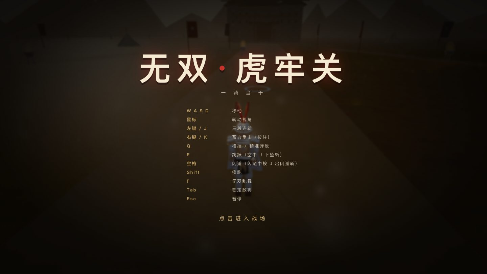

# 无双 · 虎牢关

用「一句话 → 可玩游戏」的方式做出来的浏览器割草动作游戏。单文件 HTML，零外部资源——模型、贴图、音效、UI 全部由代码生成。

渲染层在 2026-11 做了一次「实时照片级」升级：HDR 光照链、双级联阴影、程序化 PBR、骨骼动画角色。



## 快速开始

```bash
# 方式一：直接双击打开
open demos/index.html

# 方式二：本地服务器（推荐）
cd demos && python3 -m http.server 8000
# 打开 http://127.0.0.1:8000
```

需要联网（从 CDN 加载 three.js r160）。

## 操作

| 输入 | 动作 |
|---|---|
| `W A S D` | 移动 |
| 鼠标 | 转动视角（点击画面锁定鼠标；未锁定时可拖动） |
| 左键 / `J` | 三段连斩，第三段击倒 |
| 右键 / `K` | 蓄力重击（按住蓄力，越久越痛，带冲击波） |
| `空格` | 闪避（短暂无敌） |
| `Shift` | 疾跑 |
| `F` | 无双乱舞（槽满时） |
| `Tab` | 锁定最近的敌将 |
| `Esc` | 释放鼠标 |

## 玩法

- 虎牢关外平原，刀兵 / 枪兵 / 弓兵三种杂兵，同屏 60 人以上。
- 敌将 **华雄**（620）→ **吕布**（1500，带护卫）。两人体型更大、雉鸡翎 + 方天画戟，与杂兵一眼可分。讨取吕布即胜利。
- 击破数、连击数、评级（C/B/A/S/无双）、计时；每 25 击破回复 22 点体力。
- 无双槽靠命中与受击积攒，满槽后 4 秒无敌旋转攻击。

## 实现要点

### 渲染管线

| 方面 | 做法 |
|---|---|
| 色彩链路 | 场景渲染进 `HalfFloatType` RT（`EffectComposer` 默认即 HDR），中间任何 pass 不降到 8-bit；`renderer.toneMapping = NoToneMapping`，**色调映射由最终 pass 独占**（r160 里渲染进 RT 时 `toneMapping` 本来就失效，明确写出来避免误用） |
| 碰撞 | **静态碰撞体 + 兵器 + 箭矢**：关楼 1 个轴对齐盒（含高度 13 m）+ 营帐 ≤14 个圆（高 3.6 m）。玩家/敌兵每帧做圆-盒 / 圆-圆推出（带切向滑移），并沿朝向前伸采样点检测兵器；解算后仍相交就回退上一帧。箭矢对「上一帧→当前帧」做 3 点采样，低帧率也不穿墙。宽相用外接圆提前剔除。碎石/木箱/火盆太矮可跨过。实测：墙体 549 帧 / 34,194 单位帧零穿模；箭矢 323 箭帧零穿透 |
| 后期 | 4 个 pass：`RenderPass` → `BattlefieldAtmosphere` → `UnrealBloomPass` → 自写 Grade（ACES + 曝光 1.06 + 对比 1.09 + 饱和 0.94 + 分离色调 0.028 + 暗角 0.07 + **暗部抬升 0.035**） |
| 大气 | 半分辨率单 pass 完成 SSAO（8 sample + 深度双边模糊）、高度雾（`exp(-h/1.5)` 沿视线积分，系数 .007）、god rays（16 步径向模糊）；复用 `depthTexture`，**无额外 prepass**；合成时雾色混合系数 .26 |
| 阴影 | 双光源级联：主太阳 2048²（半径 20 m）+ 跟随玩家的近端光 2048²（半径 8 m），`PCFSoftShadowMap`；20 m 外由**贴地接触阴影**（`shadowIM`，对全部单位生效）兜底，因此远景单位不会浮空，也无需第三级级联 |
| 环境光 | 程序化 equirect 1024×512 → `PMREMGenerator`；含太阳盘、天空渐变、地面反弹色，太阳方向与平行光一致 |
| 材质 | 5 类 PBR：淬钢（metalness .96 / roughness .26 / anisotropy .38）、织物（sheen .65）、干裂黄土（roughness .9）、木漆（clearcoat .22）、皮肤（thickness + 低强度 sheen）；角色 PBR 贴图 1024²（albedo/roughness/normal），甲片与布料的细grain 在片元着色器里解析生成 |
| 地面 | 2048² 程序化 albedo + 由高度图生成的 normal + roughness；双尺度 UV 去平铺 |
| 后期降级 | `quality ∈ [0.55, 1.0]`，只降渲染比例 / SSAO 采样 / 体积光开关 / 阴影分辨率 / 尘粒数 |

### 角色（骨骼动画）

| 方面 | 做法 |
|---|---|
| 建模 | Blender 5.3 生成 5 套 skinned 角色：赵云 2412 面、刀兵 2148、枪兵 2108、弓兵 2780、敌将 3492；每套 **21 根骨**、**10 个 clip**（idle/walk/run/atk1-3/heavy/hit/die/musou） |
| 蒙皮 | 每顶点 ≤ 2 根权重影响（格式支持 4 槽），肘/膝用**平滑过渡**而非硬切换（消除突跳），权重归一化误差 ~3e-8；实测英雄模型 1353 顶点中 401 个为双权重 |
| 单网格 | 每个角色所有部件合并为**一个 `SkinnedMesh` / 一个材质**，靠顶点色 + 贴图区分——这是 60 人同屏 draw call 不爆的关键 |
| 动画 | `AnimationMixer` + `crossFadeTo`；**按距离分档更新**：≤18 m 60 Hz、18–35 m 20 Hz、35–60 m 10 Hz、>60 m 冻结姿态 |
| 静态合批 | 静态道具按材质合并成 `static-AO-batch`，降低 draw call |

### 性能

| 场景 | 帧率 | draw call | 三角面 |
|---|---|---|---|
| 91 人同屏 | 60 fps | 173 | 866 K |
| 121 人同屏 | 60 fps | 206 | 1.15 M |

画质自适应收敛到 `quality ≈ 0.8`。

**长时间稳定性**（2 分钟压测 / 14 轮刷兵与清场 / 约 900 击破）：fps 全程 60，`renderer.info.memory.geometries` 恒 60、`programs` 恒 39（无几何/着色器泄漏），堆内存 22–46 MB 波动无增长趋势。`textures` 从 130 升到 ~172 后趋稳——这是**每个 `Skeleton` 一份 bone texture** 造成的，上限由槽位数 `MAXE=170` 决定，属有界占用而非泄漏。**注意**：刚大批量刷兵时画质还没降下来，会有数秒的瞬时掉帧（可低至 ~45 fps），约 8 秒后收敛到 60 fps。

### 音频

WebAudio 全程合成：挥空、命中、交击、重击、铜锣、无双、弓弦、脚步；总线过 `DynamicsCompressor`。

配乐是**三层自适应**：战鼓（始终，增益随强度 0.78–1.12）→ 低音持续（强度 > .3 每小节一记）→ 高频反拍碎点（强度 > .65）。强度由连击数驱动（`combo/40`），同时把 bpm 从 88 推到 114，用 0.4 s lookahead 调度避免抖动。

## 目录

```text
zhen-sanguowushuang/
  demos/index.html                  单文件成品（3159 行 / 632 KB）
  prompts/01-musou.md               任务提示词（第一版）
  prompts/02-photo.md               任务提示词（渲染层升级到实时照片级）
  prompts/builder_system.md         系统提示词
  scripts/run.sh                    无人值守 headless 运行器
  scripts/verify.py                 验收：旧 18 条断言
  scripts/verify_photo.py           验收：新 14 条（P1–P14），内部会先跑旧 18 条
  scripts/blender/build_geometry.py 角色部件建模（旧管线，产出的 GEO_B64 仍向后可读）
  docs/screens/                     验收截图
  runs/                             run.sh 产出（已 gitignore）
```

新增的骨骼绑定 / 蒙皮 / clip 的生成脚本以 `BLENDER_RIG_PY` 注释块**内嵌在 `demos/index.html` 末尾**；提取该注释传给 `blender --background --python-expr` 即可重建，且只写回 `demos/index.html`。验收器同样以内嵌注释 `PHOTO_VERIFY_PY` 形式存在于产物中，并已提取为可执行文件 `scripts/verify_photo.py`。

## 验收

```bash
python3 scripts/verify.py          # 旧 18 条
python3 scripts/verify_photo.py    # 先跑旧 18 条，再跑新 14 条
```

`verify_photo.py` 会打印每条断言的**实测值**，并输出资产清单（材质参数、贴图尺寸、骨骼数、clip 名）供人工核对。

实测（Apple M1 / Chrome / 1440×810）：

```text
旧 18 条：18/18
新 14 条：13/14   （P13 需人眼确认画面无明显平铺，脚本无法自证，恒为 FAIL）

P10：60.25 fps / 178 draw / 885 K tris（刷满 60+ 单位）
P11：mean=0.436 · clipped=0.36% · nearBlack=2.34%（1296×729）
WebGL: ANGLE (Apple, ANGLE Metal Renderer: Apple M1)
```

P1–P12 实测要点：`hdr=true`（全部 RT 含 bloom mip 链均为 HalfFloat）、`toneMapping=0`、`outputColorSpace=srgb`、阴影 2048²×2 级联、5 类 PBR、地面三通道 2048²、5 套骨骼各 21 骨、10 个 clip 齐全、权重影响 2 根、LOD 三档（10/20/60 Hz）同时命中。

## 与 prompt 方法的关系

这个项目按 `14-doc/prompt-playbook.md` 的四层结构组织：

| 层 | 文件 | 作用 |
|---|---|---|
| 任务层 | `prompts/01-musou.md`、`prompts/02-photo.md` | 可数清单 + 硬约束 + 可测指标 |
| 系统层 | `prompts/builder_system.md` | 交互契约、感知边界披露、汇报格式 |
| 运行层 | `scripts/run.sh` | 无人值守、预算上限、缓存 TTL |
| 验收层 | `scripts/verify.py` + `scripts/verify_photo.py` + `__dbg` | 把「完成」变成可执行的断言 |

关键设计：提示词里每个「自然 / 随机 / 好看」都翻译成数字或可数项（`≥3 个变体`、`60+ 同屏`、`N 项音效`、`≤260 draw`、`≥58 fps`），系统提示词里明确告诉模型「你听不见声音，用 `OfflineAudioContext` 查削波」「你可能是软渲染，读 renderer 字符串并披露」。

第二次任务（`02-photo.md`）额外加了「验收脚本由模型自己写，但评分权不在它手里」的元规则：阈值必须逐字取规格数值、每条断言必须打印实测值、不许跳过或 `try/except` 掉任何一条。实测中这条规则起了作用——它自报 13/14 且没有偷偷放宽阈值（58 fps / 260 draw / 1.5 M tris 逐条核对一致）。

## 已知限制

- 角色是**低模骨骼**（2.1–3.5 K 面 / 21 骨 / 每顶点 2 根权重），近看仍有低多边形硬边，关节形变偏「硬」。
- 雾、SSAO 与色调曲线经过一轮调优（雾混合 0.48 → 0.26、对比 1.09、暗部抬升 0.035），锐度从升级初版的 ~2.6 恢复到 3.5–4.8、饱和度 0.51（升级前 0.50）。但**近黑占比对场景内容敏感**：同一份代码在「开局空旷」下 nearBlack ≈ 2%，在「刷满 60 人」下会升到 8–12%，P11 的 ≤12% 余量不大。
- 产物带 CSP（外部脚本只允许 three CDN）。最初用 sha256 钉住内联脚本，**任何一次代码修改都会让整页失效**，已改为 `'unsafe-inline' 'unsafe-eval'`。
- 刚大批量刷兵时有数秒画质收敛期掉帧（见「性能」）。
- 音效未经人耳试听，只做了离线削波检查（峰值 0.129、零削波样本）。
- 只有一张地图、两名敌将；没有存档、没有成长系统。
- 只有**关楼与营帐**参与碰撞；碎石、木箱、火盆、拒马、战旗可以穿过（太低或太细，穿模不明显）。
- 单位之间只有软分离力，没有实体碰撞；大规模挤在一起时会出现轻微穿插。
- 手柄未适配。
- 验收器内嵌在 HTML 注释里以守住「单文件」约束；`scripts/verify_photo.py` 是它的提取版，改渲染逻辑时需两处同步。